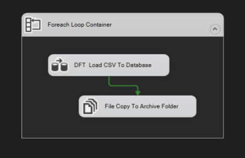
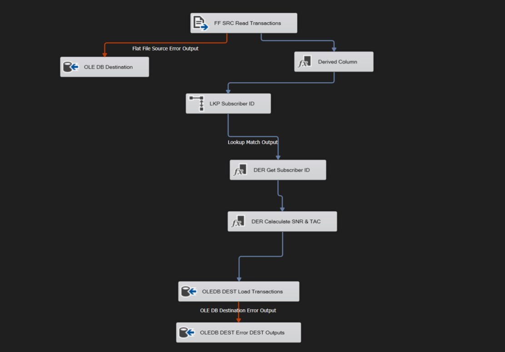
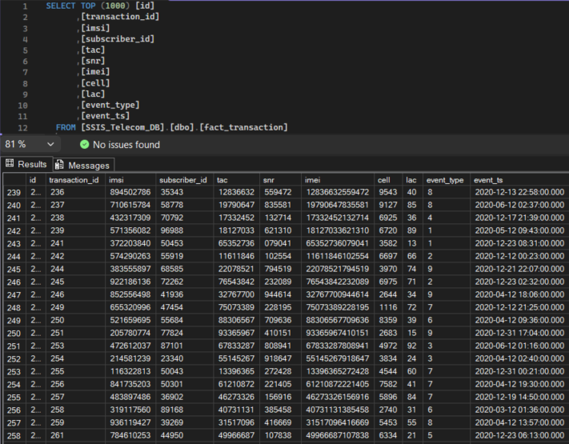

<div align="center">

# Telecom ETL Pipeline using SSIS

**A file-driven ETL pipeline for transforming, validating, and loading telecom transaction data into SQL Server.**

Built with **SQL Server Integration Services (SSIS)** and **Microsoft SQL Server**.

</div>

---

## Overview

This project implements an ETL workflow for a telecom transaction-processing scenario. Source transactions arrive as CSV files, and an SSIS package processes the files, applies data transformations and subscriber lookups, loads valid records into SQL Server, routes configured errors to dedicated tables, and archives files after successful processing.

The package uses a **Foreach Loop Container** and SSIS variables to process multiple files from a configured directory. The workflow recreates the core ETL scenario from the reference task using SSIS.

## Key Features

- **Multi-file processing:** Iterates over CSV files in a configured source folder.
- **Data transformation:** Applies the required field mappings and derives TAC and SNR from IMEI.
- **Reference lookup:** Resolves subscriber IDs using IMSI reference data.
- **SQL Server loading:** Loads processed records into `fact_transaction`.
- **Error routing:** Separates source-side and destination-side error outputs.
- **File archiving:** Moves or copies a file to the archive location after its Data Flow completes successfully.

## Technology Stack

| Technology / Component | Purpose |
|---|---|
| SQL Server Integration Services (SSIS) | ETL orchestration and data-flow execution |
| Microsoft SQL Server | Stores reference data, transactions, and error outputs |
| CSV Flat File Source | Reads incoming transaction files |
| Foreach Loop Container and SSIS Variables | Iterates over files and supports dynamic file processing |
| Lookup Transformation | Matches IMSI values against subscriber reference data |
| Derived Column Transformation | Prepares and derives transaction fields |
| OLE DB Destination | Writes transaction and error-output rows to SQL Server |

## ETL Workflow

### 1. Control Flow

The Control Flow uses a **Foreach Loop Container** to iterate over CSV files. For each file, the package runs the Data Flow task and then executes the archive step after successful processing.

<p align="center">
  
</p>

### 2. Data Flow

The Data Flow reads each CSV file, applies derived-column transformations, looks up subscriber information using IMSI, calculates TAC and SNR from IMEI, and loads the output into SQL Server. Separate error paths route configured source and destination errors to their respective tables.

<p align="center">
  
</p>

## Source Data Specification

The task describes the incoming CSV with the following fields:

| Column | Type in task specification | Nullable | Example |
|---|---|:---:|---|
| `ID` | Integer | No | `156` |
| `IMSI` | String (length 9) | No | `310120265` |
| `IMEI` | String (specified length 14*) | Yes | `490154203237518` |
| `CELL` | Integer | No | `123` |
| `LAC` | Integer | No | `12` |
| `EVENT_TYPE` | String (length 1) | Yes | `1` |
| `EVENT_TS` | Timestamp | No | `16/1/2020 7:45:43` |

> **Specification note:** The task lists IMEI length as 14, while the sample value contains 15 digits and the mapping rules refer to a 15-character length check. This discrepancy should be resolved against the intended business rule and the actual package configuration.

## Transformation and Mapping Rules

The following table summarizes the mapping requirements defined in the task.

| Source field | Transformation / rule | Target field |
|---|---|---|
| `ID` | Pass through | `Transaction_id` |
| `IMSI` | Pass through; reject records where the required value is null | `IMSI` |
| `IMSI` | Look up subscriber reference data; use `-99999` when a subscriber ID is unavailable | `subscriber_id` |
| `IMEI` | Extract the first 8 characters; use `-99999` when the value is null or fails the specified length check | `TAC` |
| `IMEI` | Extract the last 6 characters; use `-99999` when the value is null or fails the specified length check | `SNR` |
| `IMEI` | Pass through | `IMEI` |
| `CELL` | Pass through; reject records where the required value is null | `CELL` |
| `LAC` | Pass through; reject records where the required value is null | `LAC` |
| `EVENT_TYPE` | Pass through | `EVENT_TYPE` |
| `EVENT_TS` | Validate the timestamp; reject records when it is null or invalid | `EVENT_TS` |

*The table describes the task's intended rules. Actual runtime behavior depends on the transformations, conditional logic, and SSIS error-output settings configured in the package.*

## Database Design

The project uses the `SSIS_Telecom_DB` database and the following tables:

| Table | Purpose |
|---|---|
| `dim_imsi_reference` | Reference data used to resolve subscriber IDs from IMSI values |
| `fact_transaction` | Destination table for processed telecom transactions |
| `err_source_output` | Stores rows routed through the source-side error output |
| `error_destination_output` | Stores rows routed through the destination-side error output |

## Error Handling

The Data Flow contains separate error paths for source-side and destination-side errors.

- **Source-side error output → `err_source_output`**
- **Destination-side error output → `error_destination_output`**

The errors captured depend on the SSIS components and error-output dispositions configured in the package. Business-rule rejections, such as missing required values, should be considered separately from component-level conversion or destination errors.

## Results

The screenshot below shows transaction records in `fact_transaction` after loading into SQL Server.

<p align="center">
  
</p>

To inspect the loaded data in SQL Server Management Studio (SSMS):

```sql
USE SSIS_Telecom_DB;
GO

SELECT TOP (100) *
FROM dbo.fact_transaction;
```

## Repository Structure

The repository can be organized as follows. Keep the paths below aligned with the files actually committed to GitHub.

```text
Telecom-ETL-Pipeline-SSIS/
├── docs/
│   └── images/
│       ├── control-flow.png
│       ├── data-flow.png
│       └── loaded-data.png
├── SSIS solution and package files
├── SQL scripts (if included)
└── README.md
```

## Setup and Execution

1. Open the SSIS solution in a compatible Visual Studio / SQL Server Data Tools environment.
2. Create the `SSIS_Telecom_DB` database and the required tables, including the IMSI reference data.
3. Configure the OLE DB connection manager for your SQL Server instance.
4. Configure the source folder, archive folder, and SSIS variables used for file iteration.
5. Verify the Flat File Connection Manager, delimiters, column metadata, and timestamp format against the input CSV files.
6. Run the package.
7. Check the loaded records in `fact_transaction` and inspect `err_source_output` and `error_destination_output` for routed errors.

Exact setup steps may vary depending on the installed SQL Server, SSIS, and Visual Studio versions.

## Notes

- This is an SSIS implementation of the telecom ETL scenario described in the task; the reference learning series uses Scala.
- The screenshots document the package design and an example of the loaded data. They are stored under `docs/images/` and are referenced directly by this README.
- Do not commit credentials, private connection strings, or sensitive telecom/customer data.
